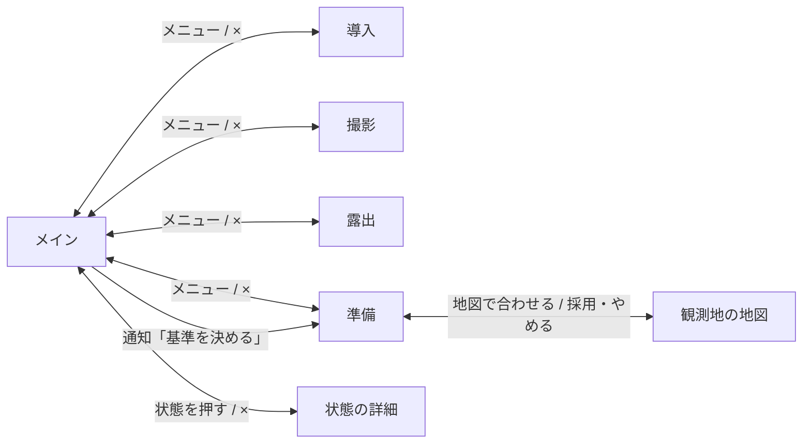

# SPA の UI 整理（2026-11-27 実装、利用者が確認済み）

整理前の記録は [ui-structure.md](ui-structure.md)。

## 実装で案から変えた点

- 右側のパネルは停止ボタンの列の左に出す。開いている間は映像をパネルの左に寄せる（スマホ幅では、重ねるだけだと映像の中央が隠れるため）
- 観測地の地図は右側パネルではなく、準備の上に重ねる大きな枠
- 主鏡のラベルは左上の状態の枠の下
- 向きの基準を選ぶと確認ダイアログを出す

## 方針

1. 観測中に使うものだけを常時表示し、準備でしか使わないものは「準備」に入れる
2. 同じ情報は 1 か所に出す
3. 正常なときは黙り、異常なときだけ文字を出す
4. ダイアログは右側のパネルにして映像の中央を隠さず、× を押すまで閉じない

## UI 要素ツリー（案）

```text
SPA (/)
├─ 映像（主鏡 / ファインダー、ワイプに触れて入れ替え。ワイプは幅 22%）
│  └─ レティクル（中央の短い十字だけ。端までの線は「準備 > 表示」で出す）
├─ 状態と向き（左上の 1 枠。上の段はアイコン 4 つ。異常な項目だけ文字を添える。押すと詳細）
│  └─ 詳細: 接続・基準・録画・電源の文、全画面
│  下の段は「方位 27.6°  高度 1.2°」。基準がない値は色を変えて「仮」）
├─ メニュー（右上、4 つ）
│  ├─ 導入
│  ├─ 撮影
│  ├─ 露出
│  └─ 準備
├─ 操作ドロアー（左下、下の「操作ドロアー」を参照）
│  ├─ 切り替えボタン: パン/ティルト、フォーカス
│  └─ 中身: スティック / フォーカス / なし
├─ 通知（最上部中央、警告、進行中の処理、「太陽に向けないでください」）
├─ 架台の接続・切断、停止（右下）
└─ 右側パネル（同時に 1 つ、× で閉じる）
   ├─ 導入: 天体ボタン、検索、情報、導入の計画、追尾の開始と停止
   ├─ 撮影: 静止画・タイムラプス・動画のタブ、開始 / 停止、直近の画像、一覧
   ├─ 露出: 主鏡 / ファインダー、手動、露出、ゲイン
   └─ 準備（タブ）
      ├─ 向き: 向きの基準を選ぶ、プレートソルブ、北極星の登録
      ├─ 空の範囲: 円盤、高度の下限、保存
      ├─ 観測地: 現在値、測る、地図で合わせる、数値の直接入力（折りたたみ）
      └─ 表示: 横並び、十字線、ファインダーの照準と拡大
```

説明文は「？」を押したときだけ出す。

## 操作ドロアー

スティックとフォーカスは同時に使うことがほぼないので、左下の同じ場所で切り替える。フォーカスは自動追尾中か停止中に使う。

| 状態 | 左下の表示 | パン/ティルトを押す | フォーカスを押す |
|---|---|---|---|
| スティック | ボタン 2 つとスティック | なしへ | フォーカスへ |
| フォーカス | ボタン 2 つと微動・中・速、逆転・正転 | スティックへ | なしへ |
| なし | ボタン 2 つだけ | スティックへ | フォーカスへ |

- 自動では格納しない
- 切り替えボタンは左端に縦に固定し、中身はその右に出す（状態が変わってもボタンは動かない）
- 切り替えるときは、操作中のスティックやフォーカスを止める
- フォーカスはダイアログではなくなるので、右側パネルと同時に出せる。映像やほかのパネルに触れても閉じない
- 選んだ状態は端末に保存する（Claude の案）

## 画面上部の配置

- 左上は状態と向き、中央は通知、右上はメニュー
- 通知は左右の枠の間に収まる幅にし、長い文は折り返す。スマホの幅は実機で合わせる
- 向きは状態の枠の 2 段目に置き、枠の横幅を広げない
- 映像のラベル（今は上中央の「主鏡」）は通知と重ならない位置へ移す

## 画面遷移（案）



## 現状からの変更

| 現状 | 案 |
|---|---|
| 状態はアイコンと文字を常時表示 | 正常時はアイコンだけ |
| 向きは上中央の独立した枠 | 左上の状態の枠に統合 |
| 通知は下中央 | 最上部中央 |
| 架台の接続ボタンが右下に常時 | 残す |
| メニュー 6 個 | 4 個 |
| 表示の切り替えボタン | ワイプに触れて入れ替え。横並びは準備へ |
| ファインダーの道具が下中央 | 準備の表示タブへ |
| 全画面ボタン | 状態の詳細へ |
| 「太陽に向けないでください」の通知 | 残す |
| スティックは左下に常時、フォーカスは右下のボタンから開く | 左下のドロアーで切り替え |
| 映像やスティックに触れるとダイアログが閉じる | × を押すまで開いたまま |
| 開き直すと未保存の入力が消える | 閉じても入力を保持 |

停止は今のまま（常に不透明、1 タップ）。スティックとフォーカスの動き方、半透明の扱いも変えない。

## 向きの基準を選ぶ画面がなかった（今回追加）

ホストには `GET/POST /api/reference` があるが、`web/` にこれを呼ぶコードがない。通知は「向きの基準を選び直してください」と出るので、準備の向きタブに選択肢（北・水平で電源投入、登録した目標）を置く。これは整理と別に必要。

## 実装の順（実施済み）

1. 向きの基準の選択を足す
2. 右側パネル化と、閉じる条件の変更
3. 左下の操作ドロアー
4. メニューと状態表示の整理
5. 準備のタブ分け
