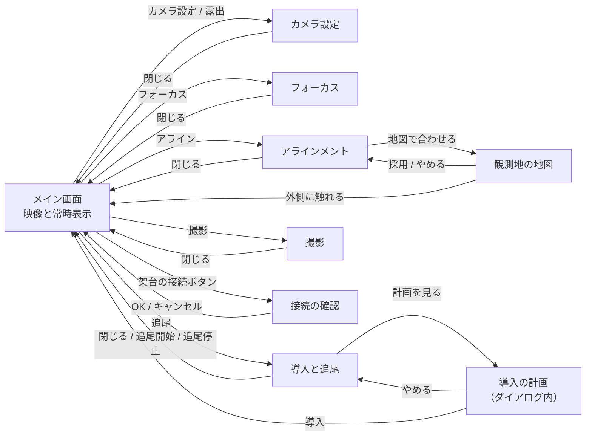
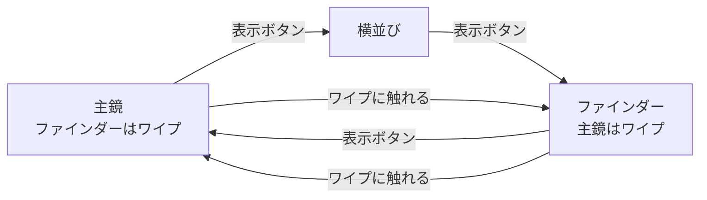

# SPA の UI 構造（整理前、2026-11-27）

`web/index.html`、`web/app.js`、`web/style.css` から起こしたもの。整理する前の現状の記録で、ブラウザでの動作確認はしていない。

## 1. UI 要素ツリー

凡例: ★ 常に表示 / ◇ 条件で表示 / （ ）内は押せる条件や補足

```text
SPA (/)
├─ 映像 #views（表示モード: 主鏡 / 横並び / ファインダー）
│  ├─ ★ 主鏡の映像
│  │  ├─ ★ レティクル（赤、十字線は画面の端まで）
│  │  └─ ★ ラベル「主鏡」（映像がないとき「（映像なし）」）
│  └─ ★ ファインダーの映像（主鏡表示ではワイプ）
│     ├─ ★ レティクル（水色、照準の位置は保存される）
│     └─ ★ ラベル「ファインダー」
├─ ★ 状態 #status（左上、表示のみ）
│  ├─ 接続: 接続 正常 / 異常 / 架台・カメラの異常 / 切断中 / サーバー 切断 / 確認中
│  ├─ 基準: アライン済 / 未アライン / 基準なし / 制限モード
│  ├─ 録画: 録画なし / 動画 / タイムラプス / 静止画
│  └─ 電源: OK / 半分 / 残り僅か
├─ ★ 向き #pointing（上中央）: 方角・仰角、基準がない直結版は電源投入時からの角度
├─ ★ メニュー #menu（右上）
│  ├─ 表示: ○○（3 モードを順に切り替え）
│  ├─ アライン
│  ├─ 追尾
│  ├─ カメラ設定
│  ├─ 撮影
│  └─ 全画面
├─ ◇ ファインダーの道具 #finder-tools（横並び・ファインダー表示のとき）
│  ├─ ×1 / ×2 / ×4 / ×8
│  ├─ 照準を置く（オン中は映像タップで照準を移動）
│  ├─ 中央へ
│  └─ 露出（→ カメラ設定をファインダー側で開く）
├─ ★ スティック #stick（左下、パン / ティルト）
├─ ◇ 通知 #notice（下中央、1 件だけ。下の「通知の優先順」を参照）
├─ ★ 架台 接続中 / 接続待ち / 切断中（右下、押すと確認して切り替え）
├─ ★ フォーカス（右下、→ フォーカス）
├─ ★ 停止（右下）
└─ ダイアログ（同時に 1 つ）
   ├─ カメラ設定 #camera
   │  ├─ 対象: 主鏡 / ファインダー
   │  ├─ 手動露出
   │  ├─ 露出（手動のとき）
   │  ├─ ゲイン
   │  └─ 閉じる
   ├─ フォーカス #focus
   │  ├─ 状態の文
   │  ├─ 微動 / 中 / 速
   │  ├─ − 逆転 / ＋ 正転（押している間。ドライバー接続時）
   │  └─ 閉じる
   ├─ アラインメント #align（縦スクロール、3 つの機能が同居）
   │  ├─ [北極星]
   │  │  ├─ 現在の登録状態、観測地
   │  │  ├─ 説明文
   │  │  ├─ 北極星を登録 / 解除 / 閉じる
   │  │  └─ 天体の表（方角、仰角、差）
   │  ├─ [プレートソルブ]
   │  │  ├─ 説明文
   │  │  ├─ 空の範囲の円盤（指でなぞる）
   │  │  ├─ 高度の下限 / 全方位 / 空の範囲を保存
   │  │  ├─ アラインメント開始 / 中止（実行中かどうかで片方だけ有効）
   │  │  └─ 進行の文、各点の表
   │  └─ [観測地]
   │     ├─ 緯度 / 経度 / 標高
   │     ├─ 地面 / 地面から望遠鏡 / ジオイド高
   │     ├─ 状態の文、説明文
   │     └─ この端末の位置を測る / 地図で合わせる（→ 地図） / 観測地を保存
   ├─ 観測地の地図 #site-map
   │  ├─ ＋ の位置の座標
   │  ├─ 地図と中央の ＋
   │  ├─ 注意書き
   │  └─ 標準地図にする・写真にする / 測位の位置へ / この位置を採用 / やめる
   ├─ 天体の導入と追尾 #track
   │  ├─ よく使う天体のボタン
   │  ├─ 名前か座標の入力 / 調べる
   │  ├─ 天体の情報（2 秒ごとに更新）
   │  ├─ ◇ 導入の計画（この計画で導入 / やめる）
   │  ├─ 自動導入の計画を見る（天体が地平線の上のとき）
   │  ├─ 映像で補正する
   │  ├─ この天体を追尾 / SynScan の追尾に戻す
   │  ├─ 説明文
   │  └─ 追尾を止める / 閉じる
   └─ 撮影 #capture
      ├─ 撮影の状態、空き容量
      ├─ ◇ エラーの知らせ（OK）
      ├─ 対象名
      ├─ 静止画（待機中のみ）
      ├─ タイムラプス + 間隔（待機中のみ）
      ├─ 動画 + 秒数（待機中のみ）
      ├─ 説明文
      ├─ 撮影を止める（タイムラプス・動画中） / 閉じる
      ├─ ◇ 直近の画像
      └─ 撮影の一覧

ブラウザの確認ダイアログ: 架台の接続・切断
別ページ: /stop（全画面の停止ボタンのみ。SPA からのリンクはない）
```

### 通知の優先順（上が優先）

1. サーバーに再接続中
2. 架台との接続を切っている
3. 架台の通信エラー
4. 安全装置で停止
5. 可動範囲の端で停止
6. ホストからの知らせ（電源の入り直しなど）
7. 導入後の「解いて寄せる」の進行
8. 自動導入の進行
9. 追尾の状態
10. 撮影のメッセージ
11. 向きの基準なしの注意
12. 「太陽に向けないでください」（サーバー接続中で他に何もないとき）

ボタン操作のエラーも同じ場所に直接書くが、次の状態の受信で上書きされる。

## 2. 画面遷移図

ページは 1 枚で、遷移はすべてダイアログの開閉と表示モードの切り替え。



どのダイアログも、次の操作で閉じる。

- 映像に触れる
- 状態、向き、メニュー、ファインダーの道具、スティックのどれかに触れる
- 別のダイアログを開く

停止、架台の接続、フォーカスの各ボタンは、ダイアログを閉じる対象のパネルではない（フォーカスは開くと他のダイアログが閉じる）。

### 表示モード



## 3. 整理の材料（コードを読んで気付いた点）

画面のうるささ:

- 架台の接続状態が、左上の「接続」と右下の「架台 接続中」の 2 か所にある
- 基準がないことが、左上の「基準なし」、向きの表示、下の通知の 3 か所に出る
- メインに常時あるボタンは、メニュー 6 個と右下 3 個。アライン、観測地、全画面は、観測中に何度も使うものではなさそう
- 十字線が画面の端まで伸び、ワイプも常に出ている
- アラインのダイアログに、北極星・プレートソルブ・観測地の 3 機能と長い説明文が同居している

操作の落とし穴（ブラウザでは未確認）:

- アラインを開いたままスティックを倒すと閉じる。「北極星を十字に合わせて登録」は、合わせたあと開き直すことになる
- アラインは開き直すと観測地と空の範囲を読み直すので、閉じる前の未保存の入力は消える
- 外側に触れて閉じた場合は「閉じる」の後始末が走らない。測位は最大 30 秒続き、導入の計画は次に開いても残る
